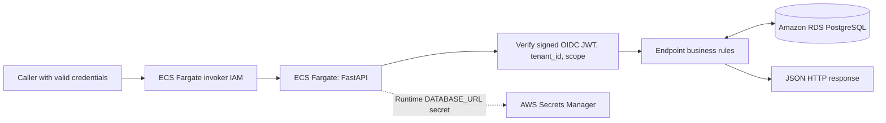

# LSK Enterprise Finance & Reconciliation Platform

**Cloud deployment branch:** `feature/aws`. Release architecture uses ECS Fargate and Amazon RDS PostgreSQL with internal HTTPS ALB with security-group restriction. See [Release Matrix](docs/RELEASE_MATRIX.md) and [AWS Deployment Guide](docs/DEPLOY_AWS.md). Network restrictions and signed application JWT/tenant verification are separate authorization boundaries. Live cloud deployment and financial compliance are unverified.


Independent portfolio lab: fictional LSK-inspired finance. Not evidence of an actual employer deployment.

AWS target: FastAPI, PostgreSQL, ECS Fargate, Amazon RDS PostgreSQL, AWS Secrets Manager, Amazon ECR, Terraform, GitHub Actions WIF.

## Security
OIDC-signed JWT, tenant and scope isolation, no payment processing, synthetic data. Restrict ECS Fargate invoker IAM. Do not commit secrets.

## Cost
Create a billing budget first. Amazon RDS PostgreSQL is charged while running. Budget alerts do not cap spending. No infrastructure is automatically deployed by this repository.

## Development
Run pip install -r requirements-dev.txt and DATABASE_URL=sqlite+pysqlite:///./test.db python -m pytest -q . See docs/ for design, operating risks, and interview guidance.


---

## Shared AWS request path

The diagrams below describe the **deployed configuration**, not a claim that this repository is currently running in AWS. The local Docker Compose environment substitutes a local PostgreSQL container for Amazon RDS PostgreSQL.



**Trust boundaries and components:** internal HTTPS ALB with security-group restriction determines whether a principal may invoke the deployed service. FastAPI **separately** checks a signed RS256 OIDC access JWT (issuer, audience, expiry, subject, tenant, and required scopes). An invoker identity token alone is not a substitute for the application's access token. Pydantic validates request bodies; the SQLAlchemy session reads/writes PostgreSQL with tenant filters. The application returns a synchronous JSON response. Terraform configures the ECS Fargate runtime service account, Amazon RDS PostgreSQL connection, AWS Secrets Manager and Amazon ECR; GitHub Actions builds/publishes containers through Workload Identity Federation. These CI/deployment components are **not** invoked by normal customer API calls.

**Operational endpoints:** `GET /healthz` responds without querying the database; `GET /readyz` queries the database. A local schema bootstrap is provided by `scripts/migrate.py`, not by incoming requests. Schema bootstrap is not a reviewed Alembic migration strategy.

**No frontend UI is included.** Use an authorized REST client or the FastAPI OpenAPI interface for the lab. No live employer integrations, real customer data, or real funds are involved.

## Business workflow: ERP record + bank record -> reconciliation decision

**Use case:** A corporate finance analyst imports synthetic ERP and bank records under a shared reference, requests a comparison, and reviews exceptions. The service is a synchronous reconciliation API, **not** a scheduled bank feed or money-transfer platform.

```mermaid
sequenceDiagram
  autonumber
  participant F as Finance/ERP client
  participant I as internal HTTPS ALB with security-group restriction
  participant A as FastAPI / JWT
  participant DB as Amazon RDS PostgreSQL
  F->>I: POST /v1/records source=erp
  I->>A: Permit invoker
  A->>A: Require finance:write + tenant, validate fields
  A->>DB: Check tenant/source/external_id; INSERT finance_records
  DB-->>A: ID or prior row
  A-->>F: 201 {id,replayed}
  F->>I: POST /v1/records source=bank
  I->>A: Permit invoker
  A->>DB: Deduplicate and persist bank record
  DB-->>A: Bank row ID
  A-->>F: 201 {id,replayed:false}
  F->>I: POST /v1/reconcile/{reference}
  I->>A: Permit invoker
  A->>A: Require finance:reconcile
  A->>DB: SELECT same-tenant rows with same reference
  DB-->>A: ERP and bank candidates
  A->>A: Exactly one of each? amount and currency equal?
  alt Exactly one pair matches
    A->>DB: UPSERT-like matched reconciliation status
    A-->>F: {status:matched,details:Exact match}
  else Missing, ambiguous or different
    A->>DB: UPSERT-like exception reconciliation status
    A-->>F: {status:exception,details:reason}
  end
  F->>I: GET /v1/exceptions
  I->>A: Permit invoker
  A->>A: Require finance:read
  A->>DB: SELECT tenant's exception reconciliations
  A-->>F: [{reference,details}, ...]
```

### Component responsibilities

| Stage | Component | Data and decision | Output |
|---|---|---|---|
| 1. Authentication | internal HTTPS ALB with security-group restriction + `get_principal()` | Invoker permission, RS256 JWT, `tenant_id` | Authorized tenant |
| 2. Ingestion | `FinanceNew`, `ingest()` | `source` must be `erp` or `bank`; external ID, reference, decimal amount and currency | `finance_records` row |
| 3. Duplicate guard | Unique `(tenant_id,source,external_id)` | Same duplicate data -> replay; changed reference/amount/currency -> conflict | Prior record or HTTP 409 |
| 4. Reconciliation | `reconcile()` | Select rows by same tenant/reference; require exactly one ERP and one bank; exact amount + currency | `matched` or `exception` |
| 5. State persistence | `Reconciliation` table | Insert initial outcome or update existing reference outcome | Latest stored status and explanation |
| 6. Exceptions | `exceptions()` | Query only tenant's rows with `status=exception` | JSON exception list |

### API example

First import an ERP row:

```http
POST /v1/records
Authorization: Bearer <OIDC_ACCESS_JWT>
Content-Type: application/json

{"source":"erp","external_id":"erp-1001","reference":"REF-1001","amount":"250.00","currency":"USD"}
```

Next import a bank row using the **same reference**:

```http
POST /v1/records
Authorization: Bearer <OIDC_ACCESS_JWT>
Content-Type: application/json

{"source":"bank","external_id":"bank-2001","reference":"REF-1001","amount":"250.00","currency":"USD"}
```

Then call `POST /v1/reconcile/REF-1001` with `finance:reconcile`. Expected response: `{"reference":"REF-1001","status":"matched","details":"Exact match"}`. If the bank record differs in amount/currency, or either source is missing, it becomes an `exception` visible through `GET /v1/exceptions` (requires `finance:read`).

### Failure behavior and boundaries

- Bad or missing JWT: 401; wrong scope/tenant: 403.
- Unknown `source` or invalid body: 422; conflicting duplicate `external_id`: 409.
- For the same reference, the service **requires one ERP and one bank record**; multiple candidates are marked ambiguous rather than auto-allocated.
- Reconciliation is explicitly invoked via HTTP. There is no background scheduler, worker, message queue, ERP connector or bank API.
- Re-running `/v1/reconcile/{reference}` updates the stored result; it does not move money, create accounting entries, or close an exception.
- This first implementation has no deterministic reference normalization, tolerances, FX conversion, partial settlements, human exception resolution, or concurrency-safe upsert for simultaneous reconciliation requests.


## Brixton JD alignment

See [technical gap review and completion criteria](docs/JD_ALIGNMENT.md). LSK is an independent fictional business.


## Multinational deployment safeguards

The LSK reference deployment supports an explicit region/tenant authorization gate and configurable Amazon RDS PostgreSQL HA sizing. Read the [multinational operating standard](docs/MULTINATIONAL_DEPLOYMENT.md) before creating regional stacks. No automatic cross-region replication or failover is configured; regional legal approval, private connectivity and operational testing remain mandatory.

## Database migration process (updated)

This repository now uses **versioned Alembic migrations**, not `Base.metadata.create_all()` for cloud initialization. A dedicated PostgreSQL 16 CI job verifies the baseline schema and database-specific constraints. Run `python scripts/migrate.py` in a separately approved one-off job, **before** routing application traffic, and record the revision through `python -m alembic current`. For an existing database created by the earlier bootstrap, use the [brownfield migration checklist](docs/SCHEMA_MIGRATION.md) before changing it. Production deployment also requires backup/restore, private network, controlled change release and legal/region reviews.

## Private regional database connectivity

An opt-in [private Amazon RDS PostgreSQL + Direct VPC egress deployment](docs/PRIVATE_DATABASE_NETWORK.md) is available. Set `enable_private_sql=true` with a reviewed non-overlapping subnet CIDR. A `prod` Terraform plan now **requires** private SQL, REGIONAL HA and a non-micro Amazon RDS PostgreSQL tier. This is still a lab reference until a real AWS plan/apply, approved security review, failover test and backup restore have been completed.


## Optional private Amazon EKS Kubernetes infrastructure

This AWS branch includes a [reusable EKS Terraform cluster module](docs/KUBERNETES_INFRASTRUCTURE.md) under `modules/eks/`, instantiated from `infra/kubernetes/` using `environments/kubernetes/{dev,staging,prod}.tfvars`. It provides isolated VPC/subnets, private Kubernetes API endpoint, NAT egress, managed node groups, explicit IAM API access, and control-plane audit logs. A dedicated **EKS Kubernetes environment plan and apply** workflow operates with AWS workload identity and a separate S3 state key for each protected environment.

**The existing ECS Fargate application stack remains unchanged.** Provisioning an EKS cluster does not deploy the business API, install IRSA/Pod Identity add-ons, wire private ingress, establish application secrets, or implement GitOps. Those release responsibilities require a separate Helm/Argo CD pipeline and live network/security testing. CI validated the Terraform module; no EKS infrastructure has been applied to an AWS account.
