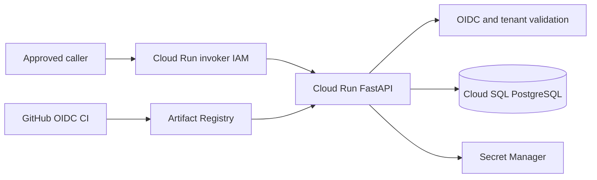

# GCP architecture

Cloud Run IAM controls who can invoke the API; a separate signed JWT controls tenant and API scopes. The lab is intentionally limited and is NOT PCI compliant or production certified.
