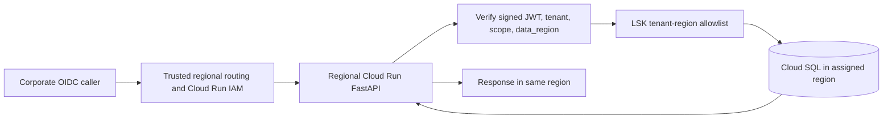

# Multinational LSK deployment standard — regional operating contract

## Deployment model

Use a **separate GCP project per environment and jurisdiction/region**, and distinct service accounts, Cloud SQL instances, Secrets, budgets, logs and Terraform state prefixes. Each tenant is assigned to an allowed region by an authorized corporate identity source. Never assume a business unit can be freely moved across national borders. Select regions after legal, contractual and data-classification reviews.



**Enforced in application code:** `LSK_ENFORCE_RESIDENCY=true` requires a signed `data_region` claim that matches the region of the deployed Cloud Run service and a tenant allowlist in `LSK_TENANT_REGION_POLICY`. The policy is created from Terraform `tenant_region_policy`. A missing policy produces 503; missing or mismatched assignments return 403. The default Terraform map is empty and intentionally denies all business tenants until mapped. The signed OIDC issuer controls claim correctness; operations teams must secure the identity provider and its signing keys.

**Example Terraform inputs (synthetic tenants only):**

```hcl
region = "us-central1"
tenant_region_policy = {
  "tenant-north-america" = ["us-central1"]
}
db_tier = "db-custom-2-7680"
db_availability_type = "REGIONAL"
```

For Europe, create an entirely separate stack with its **own** GCP project, remote Terraform state, secrets, data classification, tenant assignments and appropriately selected `region`. Never copy customer data or backup snapshots between regions without authorization.

## Governance model

| Concern | Responsibility and acceptance gate |
|---|---|
| Identity | Corporate IAM issues signed JWT tenant and region claims; scopes bound to service actions; prove unauthorized requests fail |
| Segmentation | Regional projects, VPC/private service connectivity, tenant-level DB isolation and distinct runtime service accounts |
| Data lifecycle | Approved retention, deletion, export and lawful transfer handling; database and log residency reviewed separately |
| Change control | Protected branches, peer review, policy-as-code and signed workload identity; immutable digest deployments |
| Database | Reviewed Alembic schema migrations, production-compatible Cloud SQL size, HA, PITR, backup and executed restore drills |
| Reliability | Define SLI/SLO, multi-zone failover, RPO/RTO, incident review, dashboards and load/fault-injection evidence |
| Compliance | GDPR and sectoral legal assessment, SOC2/ISO controls mapping, PCI scope determination **where applicable**; no certification is claimed |
| AI governance | Minimize prompt data, enforce read-only tool allowlists, evaluate hallucination/prompt injection, require human approval for changes |
| Cost controls | Per-region billing budgets, capacity limits, spend review; **budgets alert but do not hard-cap cost** |

## Deployment and validation sequence

1. **Design:** approve jurisdiction map, regional application ownership and data-classification matrix.
2. **Provision:** create isolated cloud project and restricted GCS remote state; review `terraform plan`.
3. **Secure network:** replace broad public ingress patterns with a reviewed API gateway/ingress choice and private DB connectivity; provision firewall/egress policy.
4. **Identity:** install corporate OIDC issuer and tenant/region claims; set explicit tenant policy in Terraform.
5. **Migrate:** run versioned database migrations using a one-off reviewed deployment job.
6. **Deliver:** publish an immutable container image, verify provenance, deploy by digest, validate Cloud Run invoker IAM.
7. **Test:** prove correct-tenant, other-tenant, wrong-region, expired-token, revoked-scope and duplicate-request behavior.
8. **Operate:** test backup restore, failure injection, health/latency/error thresholds, alert routing, rollback and recorded runbooks.
9. **Audit:** capture approval, change, data retention and evidence records; obtain required legal/security sign-off.

## What code exists today vs remaining work

**Implemented:** tenant-scoped FastAPI endpoints; region-claim and allowlist gate; SQL persistence; Terraform regional environment injection and configurable DB availability/tier; CI unit and Terraform validation.

**Not yet implemented or independently verified:** jurisdictional legal determination, API edge routing, private-only Cloud SQL/VPC for all services, production database schema migration tooling, approved global failover/data-replication rules, multi-zone GCP plan/apply test, penetration testing, compliance certification, global user directory integration, cross-region backup drills, and executed end-to-end load testing.

## Cloud-branch strategy

`main` remains the GCP baseline. Existing `feature/aws` and `feature/azure` branches were created earlier; their infrastructure does **not** automatically inherit the latest regional controls. Before deploying AWS or Azure, forward-port the code, identity policy and tests, then independently implement equivalent regional network/database architecture and validate it on that provider.

**This is an independent synthetic LSK portfolio laboratory; it is not evidence of an actual multinational production deployment.**
